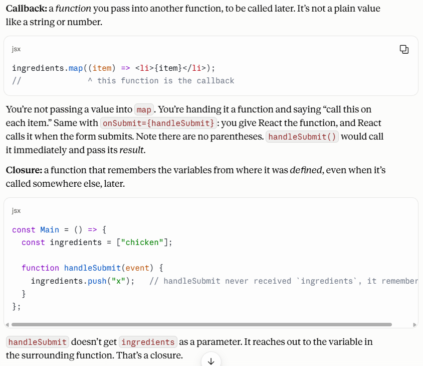

if you got a error 404 in fetch where you're using promises so this will be response not rejection bc reject means you can't able to do things 

borwser always prefer fetch then settime out or set interval 

// this in windows object point to the windows but in the node envitorment it will be empty object 

## callback and clsoure 
